# 网络管理系统图文使用教程

第 2 组课程设计 · 更新：2026-10-17（新增功能见第 13 节）

本教程带你理解并操作现有网页。**第 2～11 节用于本地练习，第 12 节完整说明真实 live 环境的访问、启动和采样。**

图 1～16 来自实际运行的 local 本地交互模式，使用独立构造样例库；`sample` 数据不能作为实测结果。图 17～18 来自 10 月 15 日只读访问 DEV 的历史记录。图 19～22 展示 10 月 17 日新增功能的实际本地 sample 操作；图 23～26 来自当日新版 DEV 真实操作。全部截图按北京时间显示。

阅读方式：直接阅读本文，或打开同目录的 `图文使用教程.html`、`图文使用教程.pdf`。HTML 内已嵌入全部图片，单独复制该文件也能阅读，点击截图可放大。

## 1. 我们要做的是什么

把自己当作机房管理员：你需要知道网络里有哪些设备、哪里出了问题、运行得快不快、用了多少流量、有没有值得关注的安全风险。

系统把设备信息采集回来，保存历史并进行计算，最后通过网页供你查询和操作。正式实验时，后台应部署在老师提供的 DEV 主机上。

| 页面功能 | 你要回答的问题 |
|---|---|
| 故障管理 | 哪个对象出现异常？何时发生、何时恢复？ |
| 配置管理 | 有哪些设备、接口和路由？前后发生了什么变化？ |
| 性能管理 | 延迟、丢包和传输速率怎么样？ |
| 计费管理 | 指定接口在这段时间经过了多少流量？ |
| 安全管理 | 实际观测是否符合规定的正常状态？ |

## 2. 启动本地练习环境

### 2.1 第一次安装

以下命令使用 Ubuntu WSL / Bash，从仓库根目录进入 `project`：

```bash
cd project
python3 -m venv .venv
source .venv/bin/activate
python -m pip install -r requirements.txt
```

已经在 `project` 目录时省略第一行；已经安装依赖时直接启动即可。Windows 原生启动方法见项目 README。

### 2.2 启动可交互的样例服务

如果之前的服务还在运行，先在对应终端按 `Ctrl+C` 停止，再执行：

```bash
NMS_API_TOKEN=local-test-only python3 run.py --mode local --port 8001 --db data/tutorial-practice-v3.sqlite3
```

保持这个终端运行，在浏览器打开 **http://127.0.0.1:8001/**。若当前代码刚刚更新，按 `Ctrl+Shift+R` 重新加载页面。

这里的 `local-test-only` 是本机练习用的示例令牌；`tutorial-practice-v3.sqlite3` 是独立练习库。练习中的确认和保存结果会保留。若想重新开始，可换成一个未使用过的库文件名，如 `data/tutorial-practice-round2.sqlite3`。

### 2.3 三种模式的用途

| 模式 | 能做什么 | 真实网络操作 |
|---|---|---|
| demo | 查看预置样例、比较快照、统计流量和下载报表 | 关闭 |
| local | 在独立样例库中增加确认记录、修改服务基线 | 关闭 |
| live | 按配置接入实验环境，查询和采集实际数据 | 每项操作还需相应开关与前置条件 |

填好管理令牌只解决操作身份校验，不会自动开启采集、端口探测或 iperf3。

## 3. 认识首页与管理令牌

### 3.1 首页怎么看

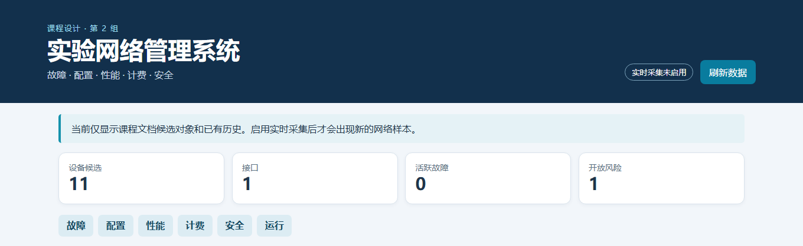

图 1：顶部是运行状态、数据刷新和五项功能入口。

- **设备候选**：当前数据库中的对象记录数量，包含文档候选及样例；不能直接理解为已经发现了这么多台物理设备。
- **接口**：已保存的网口记录数量。
- **活跃故障**：当前尚未恢复的故障数量。样例告警已经恢复，因此这里可以是 0。
- **开放风险**：状态为 `open` 的风险数量。
- **刷新数据**：重新读取数据库中的记录；它本身不向设备发起新测量。
- **实时采集未启用**：local 模式的预期状态，样例查询仍然可用。

点击“故障、配置、性能、计费、安全、运行”可以跳到对应区域。

### 3.2 先填写管理令牌

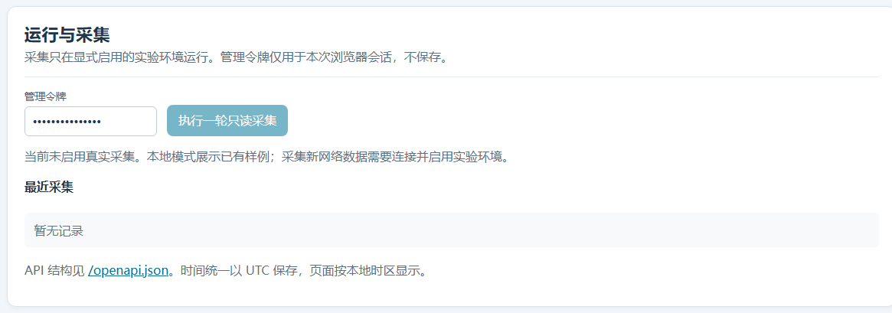

图 2：点击导航中的“运行”，在“管理令牌”输入框填入启动时设置的值：

```text
local-test-only
```

输入框显示圆点属于密码框的正常效果。令牌仅由当前页面用于发送管理请求；重新加载或打开页面后请检查并重新填写。

local 模式下，“执行一轮只读采集”置灰，并显示原因。此处“只读”指采集时只读取设备信息；采集结果仍会写入系统数据库，所以正式运行时需要管理权限。

## 4. 故障管理：发现异常并记录处理状态

### 4.1 查看某台主机的历史

1. 点击“故障”。
2. “设备筛选”选择 `sample-host-1 · 192.0.2.11`。
3. 查看上方告警与下方连通性样本。

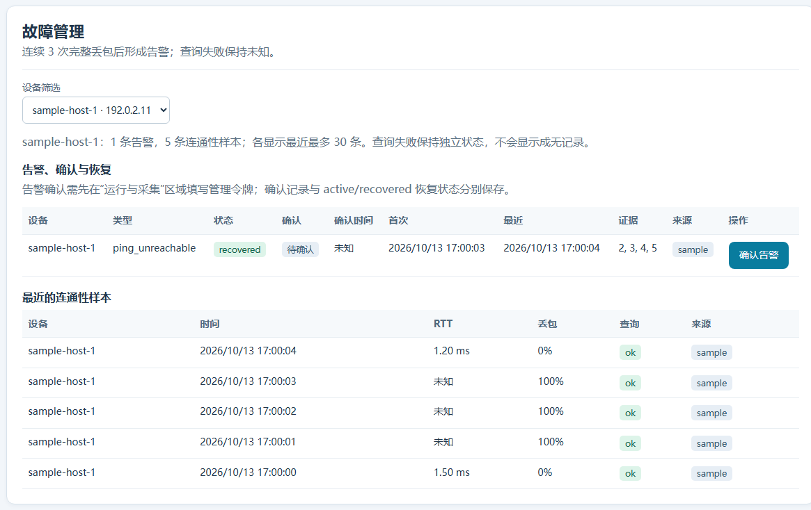

图 3：样例按时间经历“正常 → 三次完全丢包 → 恢复”。表格按较新记录优先显示，所以理解过程时从下往上读。

| 字段 | 怎么理解 |
|---|---|
| ping_unreachable | 根据连续完全丢包形成的连通性故障类型 |
| recovered | 后续样本已满足恢复条件 |
| 待确认 | 管理员尚未记录“我已看到” |
| RTT | 测试包往返所需时间，单位 ms |
| 丢包 100% | 本次测试发出的包全部未收到响应 |
| 查询 ok | 本次测试成功执行并取得结果；结果本身仍可能是完全丢包 |
| 来源 sample | 该条记录属于构造样例 |

没有有效往返响应时，RTT 显示“未知”。

### 4.2 确认告警

先按第 3 节填写令牌，再点击告警行最右侧的“确认告警”。如果表格较宽，可横向滚动。

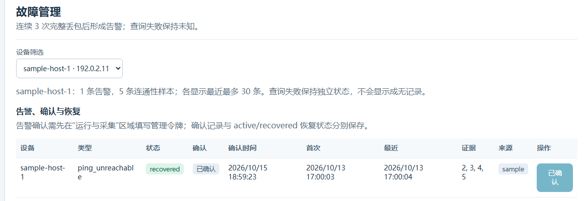

图 4：确认后出现“已确认”和确认时间，按钮变为不可重复点击。事件的 `recovered` 状态保留。

**确认表示管理员已经知悉；恢复表示后续观测满足了恢复条件**。两种信息分别记录。刷新后应仍能读到确认结果。

## 5. 配置管理：认识对象、接口、路由和变化

### 5.1 查看设备清单

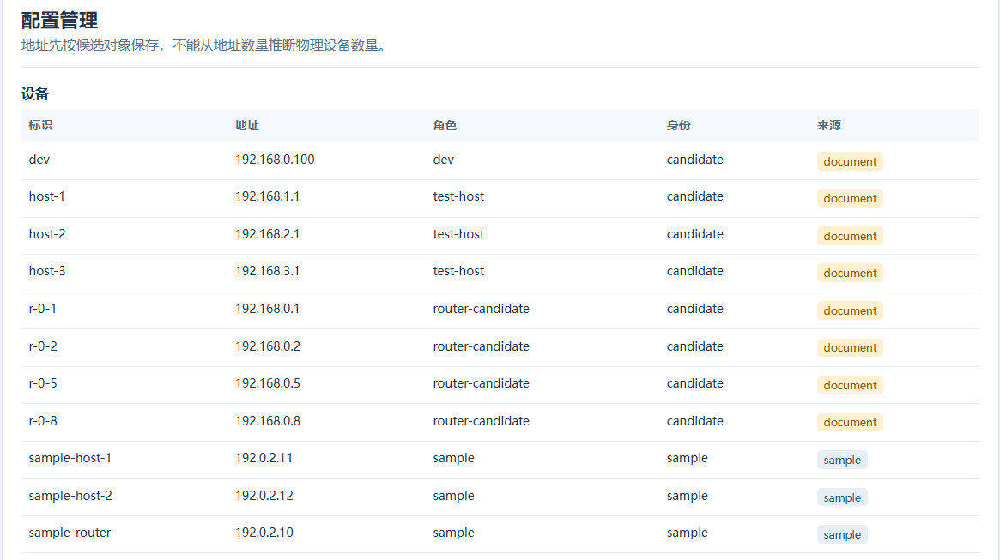

图 5：每行包含标识、地址、角色、身份和来源。

- `host-1` 等是课程文档中的测试主机对象；`sample-host-1` 等是演示对象。
- `router-candidate` 表示路由候选对象，物理设备身份仍需结合实验确认。
- `document` 表示文档录入，`sample` 表示构造样例。

### 5.2 查看接口与路由

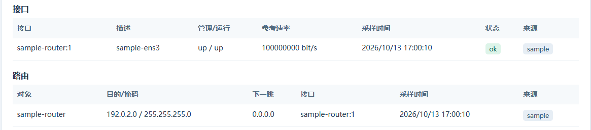

图 6：`sample-router:1` 表示样例路由器的第 1 个接口。

- **管理状态**：配置期望接口处于什么状态。
- **运行状态**：实际观测到的接口状态。
- **参考速率**：用于计算利用率的参考带宽；方向速率还需要由连续计数样本计算。
- **路由目的与掩码**：这条路由指向哪个网络。
- **下一跳**：数据要交给的下一个地址；`0.0.0.0` 通常需结合路由类型理解为直接可达。

### 5.3 比较两次配置

1. 找到“配置快照比较”，设备选择 `sample-router`。
2. 选择较早和较新的两份快照。
3. 点击“比较快照”。
4. 可展开“逻辑拓扑与快照”查看记录。

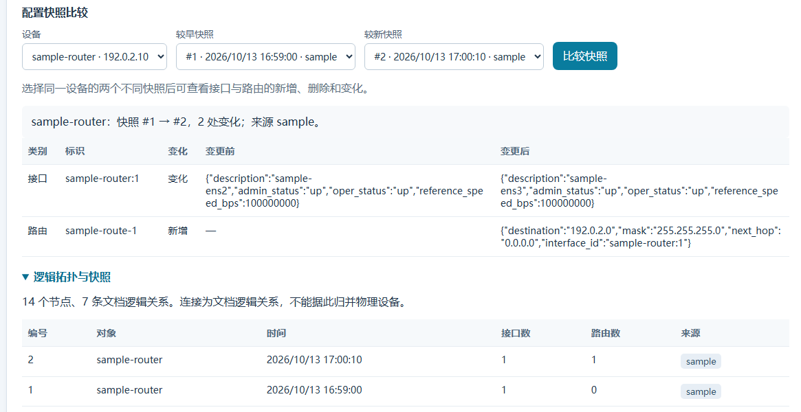

图 7 的通过标准：显示 **2 处变化**，其中接口描述从 `sample-ens2` 变为 `sample-ens3`，并新增一条样例路由。

“快照”就是某个时间点的配置记录。这里比较的是已保存的信息；当前系统主要进行只读配置管理。逻辑拓扑依据课程文档，尚不能当作完整自动发现的物理拓扑。

只有一份快照时，比较按钮置灰，需要同一对象的两份不同记录才能比较。

## 6. 性能管理：延迟、丢包、速率和吞吐量

### 6.1 查看端到端延迟与丢包

1. 点击“性能”。
2. “测试主机”选择 `sample-host-1`。
3. 对照图表与“端到端样本明细”。

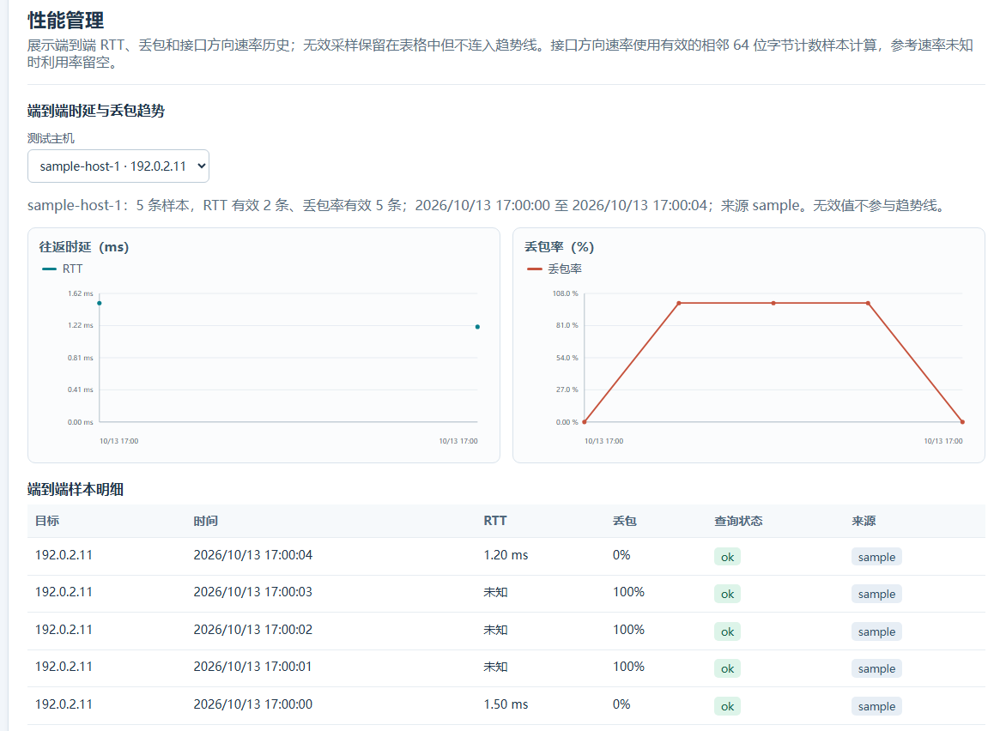

图 8：样例共 5 条记录，正常响应的 RTT 约为 1.5 ms 和 1.2 ms，中间三次完全丢包。没有有效 RTT 的区间不连接成正常曲线。

### 6.2 查看接口速率

“接口”选择 `sample-router:1`。

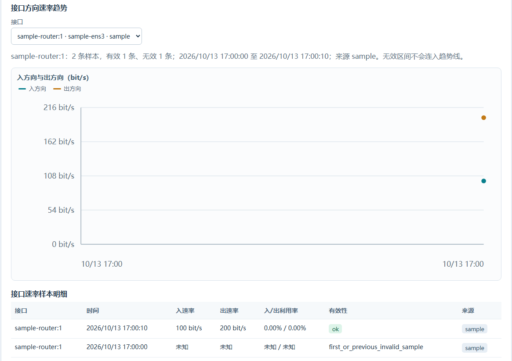

图 9：两条样本中，第一条没有前一个计数可供相减，标为 `first_or_previous_invalid_sample`；第二条有效，入方向 **100 bit/s**、出方向 **200 bit/s**。只有一个有效点时，图上主要显示数据点。

速率由两次累计字节数的差计算。例如 10 秒增加 125 byte，则入速率为 `125 × 8 ÷ 10 = 100 bit/s`。这些小数值是便于核对的样例值。

### 6.3 理解 iperf3 按钮

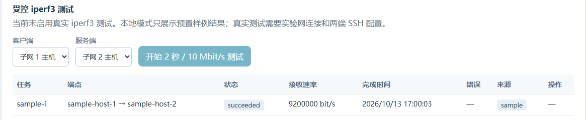

图 10：开始测试按钮置灰。下方已有的成功任务来自预置样例，用于展示结果格式。

真实 iperf3 会在两台内网主机之间启动服务端与客户端，进行短时限速传输，并记录任务结果。正式运行需要准备实验网连接、两端工具、获批的非交互 SSH 认证和功能开关。当前网页默认参数为 **2 秒、10 Mbit/s**，测得结果应按该受控测试条件解释。

## 7. 计费管理：统计流量并导出报表

当前实现按接口方向统计字节量；用户单价和真实收费账单尚未实现。

### 7.1 统计完整窗口

1. 接口选择 `sample-router:1`。
2. 方向选择“入方向与出方向”。
3. 起始时间填 **2026-10-13 17:00:00**。
4. 结束时间填 **2026-10-13 17:00:10**。
5. 点击“统计流量”。请按北京时间填写到秒。

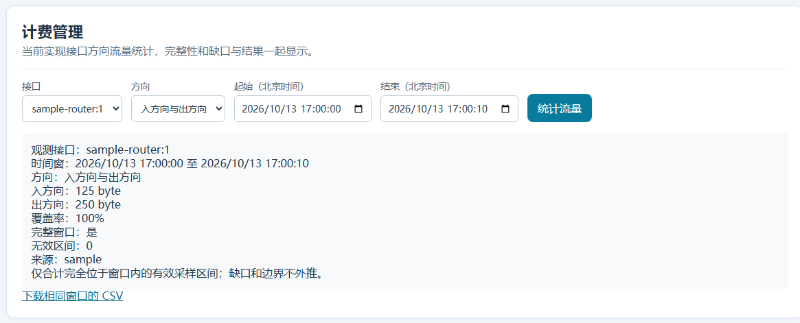

图 11 的通过标准：入 **125 byte**、出 **250 byte**、覆盖率 **100%**、完整窗口“是”。

### 7.2 观察缺口与覆盖率

只将结束时间改成 **2026-10-13 17:00:11**，再次统计。


图 12：入、出字节量保持 125 / 250，覆盖率变为 **90.91%**，完整窗口“否”。因为请求了 11 秒，只有 10 秒具备完整有效的计数区间。系统不会对剩下 1 秒自行推算。

### 7.3 导出相同窗口的 CSV

点击结果下方的“下载相同窗口的 CSV”，在浏览器下载目录找到 `traffic-report.csv`，用 Excel 或文本编辑器打开。

| direction | bytes | coverage_pct | complete | data_source |
|---|---|---|---|---|
| in | 125 | 90.91 | False | sample |
| out | 250 | 90.91 | False | sample |

CSV 应有一行表头、两行方向数据，与图 12 的窗口、方向和数值一致。也可切换为“仅入方向”或“仅出方向”，结果与导出应同步变化。

## 8. 安全管理：设定正常情况并检查风险

### 8.1 先理解三张表

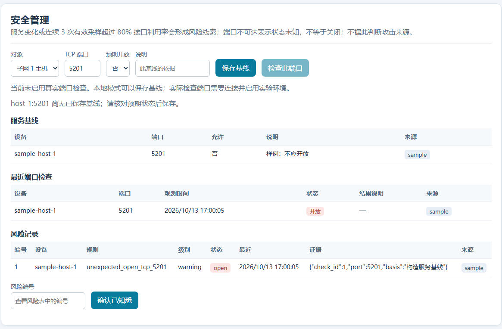

图 13：先从下方样例记录理解关系。

1. **服务基线**：你规定 `sample-host-1` 的 TCP/5201 不应开放。
2. **最近端口检查**：样例观测结果为开放。
3. **风险记录**：实际观测与预期不一致，形成 `unexpected_open_tcp_5201` 风险线索。

基线表示“预期”，检查表示“观测”。是否构成真实安全问题，还需结合服务用途进一步核查；当前系统不做完整漏洞验证或攻击源归因。

### 8.2 保存一条本地基线

先确认管理令牌已填，再在上方表单输入：

- 对象：子网 1 主机，对应 `host-1`。
- TCP 端口：`22`。
- 预期开放：`是`。
- 说明：`本地教程测试`。

点击“保存基线”。

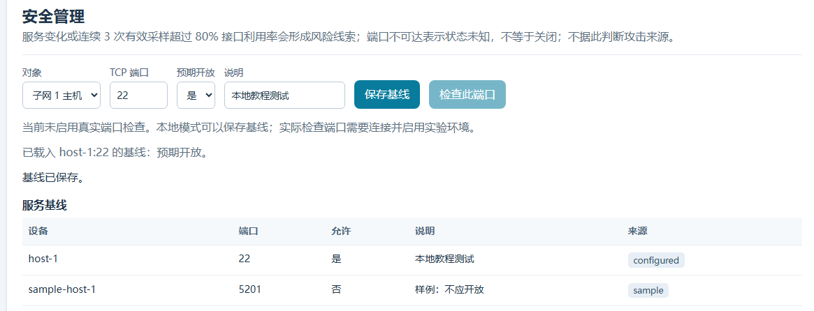

图 14：应显示“基线已保存”，表格出现 `host-1:22`，来源为 `configured`。切换对象再切回，应回填保存的预期与说明。这一步只保存本地测试库中的预期，不会连接该主机或修改其服务。

“检查此端口”在 local 模式置灰，提示正式探测所需的实验环境条件。

### 8.3 确认风险

在“风险记录”中找到样例风险编号，将它填入“风险编号”，再点击“确认已知悉”。首次练习库中通常为 `1`，以表格实际编号为准。

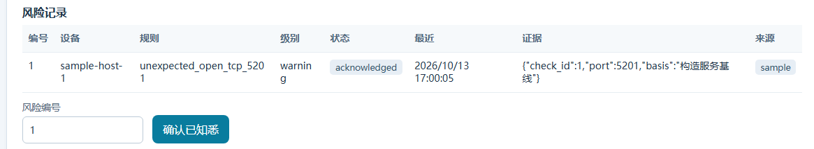

图 15 的通过标准：状态从 `open` 变为 `acknowledged`，来源仍为 `sample`。确认表示已知悉；后续观测满足恢复条件后，风险才可能进入 `resolved`。

## 9. 常见提示和报错怎么处理

### 9.1 令牌填错的例子

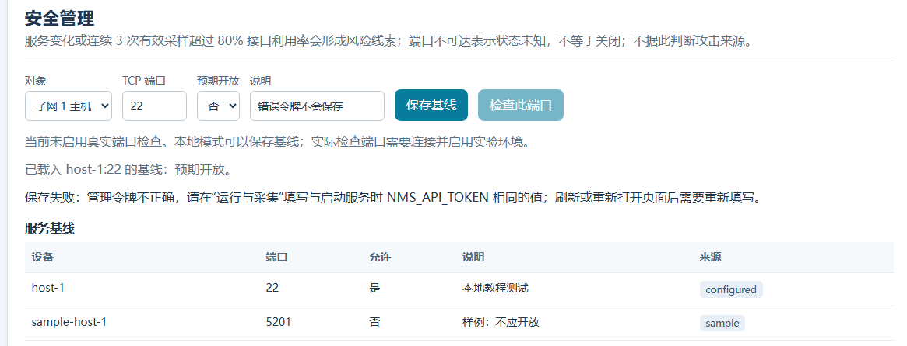

图 16 为故意填写错误令牌后尝试修改基线。页面提示“管理令牌不正确”；下方已保存的记录仍保留原值。恢复正确令牌后即可继续练习。

| 现象 | 含义与处理 |
|---|---|
| 提示先填管理令牌 | 到“运行与采集”填 `local-test-only`；这是本教程启动命令设置的值 |
| 请求返回 401 | 填写的令牌与服务不同；核对启动命令，重新打开页面后检查输入框 |
| 管理写入返回 503 | 默认 demo 为只读；需要按第 2 节启动 local 模式并配置令牌 |
| 真实网络按钮置灰 | 当前没有启用相应网络功能；local 模式预期如此 |
| 无法确认功能状态 | 服务状态读取失败；检查终端是否仍运行，恢复后刷新 |
| 配置比较按钮置灰 | 当前对象缺少两份可比较的快照；本地练习选 sample-router |
| 趋势为空 | 检查选择的主机或接口是否有记录；本地练习选 sample-host-1 和 sample-router:1 |
| 首条速率未知 | 没有前一条累计计数，暂时无法计算速率 |
| 计费显示不完整 | 查看时间范围和覆盖率；按第 7 节的固定样例时间重试 |
| 刷新后数字没增加 | 刷新只读取已有记录；local 模式不会产生新的真实采样 |
| 8001 端口被占用 | 停止自己的旧进程，或使用 `--port 8002` 并访问对应地址 |

## 10. 一遍练习下来怎么判断通过

- [ ] 首页可读，能解释文档数据、样例数据与实际采样的区别。
- [ ] 填好令牌后，故障确认显示时间；刷新后结果保留。
- [ ] 配置比较显示接口描述变化与新增路由。
- [ ] 能读到 5 条 ping 样本，理解丢包时 RTT 未知。
- [ ] 能读到接口 100 / 200 bit/s 的有效样本，并解释首样本无效。
- [ ] 完整窗口得到 125 / 250 byte、100% 覆盖率。
- [ ] 扩大窗口后覆盖率 90.91%，CSV 与页面一致。
- [ ] 能保存服务基线，并在切换对象后读回。
- [ ] 风险确认变为 acknowledged；错误令牌无法修改记录。
- [ ] 能解释真实采集、端口检查和 iperf3 为何在本地置灰。

以上说明本地页面交互、存储和计算可用于练习。真实网络验收还需在 DEV 完成实际采集及业务验证；配置真实变化、应用级 iperf3、自然故障与风险恢复等项目需各自的现场条件。任意主机对流量归属、安全检测深度等课程验收口径仍需确认。

## 11. 常用词速查

| 词语 | 简单解释 |
|---|---|
| 网元、设备 | 网络中需要管理的对象，如路由器、主机 |
| 接口 | 设备上的网口或逻辑网络接口 |
| 路由 | 决定数据发往哪个方向的信息 |
| 快照 | 某个时刻保存的一份配置记录 |
| RTT | 测试消息往返一次的时间，单位 ms |
| bit/s、byte | 前者表示速率，后者表示数据量；1 byte = 8 bit |
| 利用率 | 当前传输速率相对于可靠参考速率的比例 |
| 基线 | 管理员规定的正常或预期状态 |
| document / sample / live / configured | 文档录入 / 构造样例 / 实际采样 / 人工配置的预期 |

后续资料：项目 README、五项功能使用说明、实验环境配置、课程设计要求均位于本仓库 `project` 目录及其 `docs` 子目录。

## 12. live：真实环境的访问与启动

### 12.1 先选对路线

| 你要做什么 | 操作路线 |
|---|---|
| 使用组内已经部署在 DEV 的真实系统 | 路线 A：在自己电脑建立 SSH 转发，浏览器访问已有后台 |
| 在另一台能访问实验内网的 Linux 上运行自己的采集系统 | 路线 B：准备源码、配置文件和独立实验库，再启动 live |
| 只练习网页，暂时没有实验网权限 | 第 2 节的 local 模式 |

端口号只是访问地址。此前本机 8000 转发到 DEV、本机 8001 用于样例；这不是端口本身的固定含义。本节统一用 **18000 访问已有 DEV**、**8002 运行自己的 live 后台**，方便区分。

### 12.2 路线 A：访问已经部署的 DEV

**这条路线不需要在访问者电脑上安装 Python 或启动 run.py**。DEV 上的服务由 systemd 持续管理，访问者准备自己的 SSH 通路和浏览器即可。

第一步，使用第二组实际连接信息：

| 项目 | 第 2 组当前配置 |
|---|---|
| DEV SSH 入口 | `240a:a019::100`，TCP/22 |
| SSH 用户 | `root` |
| SSH 密码 | 课程说明中“第 2 组”的登录口令 |
| DEV 内网地址 | `192.168.0.100` |
| DEV 网页 | 远端仅监听 `127.0.0.1:8000` |

当前这台电脑已验证的代理是 Windows WARP SOCKS5 `127.0.0.1:40000`。使用已有 SSH 配置时，沿用相同的 ProxyCommand 和固定主机密钥记录；新电脑需要先准备自己到上述入口的网络通路。

第二步，在自己电脑的 WSL / Bash 执行转发命令，账号和入口已经填好：

```bash
ssh -N -T -o ExitOnForwardFailure=yes \
  -o ServerAliveInterval=20 \
  -L 127.0.0.1:18000:127.0.0.1:8000 \
  root@240a:a019::100
```

这里的含义是“本机 18000 → DEV 本机 8000”。命令适用于本机 IPv6 已可达或 SSH 已配置 ProxyCommand 的环境；需要 WARP / SOCKS5 时，保留成功登录所用的代理配置。仅打开 SOCKS5 端口不会让裸 `ssh` 自动使用代理。

保持 SSH 终端运行，浏览器打开 **http://127.0.0.1:18000/**。这台电脑原先已经可用的 **http://127.0.0.1:8000/** 也可继续使用，无需重复创建已有转发。关闭 SSH 只会断开本机访问，远端服务与历史数据库仍保留。

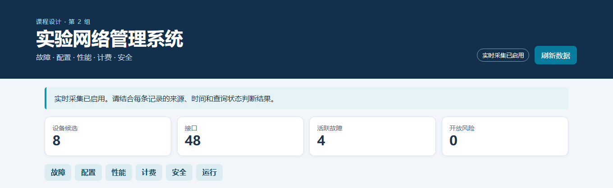

图 17：这是实际 DEV 的只读截图。页面显示采集已启用，接口等内容来自已有记录；打开页面和刷新都不会自行产生本轮测量。

第三步，取得并填写 **DEV 服务的管理令牌**。由蒋天乐提供，或登录 DEV 按下面方法读取；它与课程 SSH 登录口令、SNMP community、本地 `local-test-only` 示例令牌分别配置。未取得管理令牌时仍可查看历史记录。

维护者已经登录 DEV 时，可只读查看现有配置：

```bash
sudo less /etc/nms-team2/nms.env
```

查找 `NMS_API_TOKEN=`，复制等号后面的值，去掉包裹值的引号，粘贴到网页“管理令牌”框。按 `q` 退出查看；读取现有值无需修改文件或重启服务。普通访问者向维护者取得令牌，Git 仓库和 `.env.example` 不保存实际令牌。

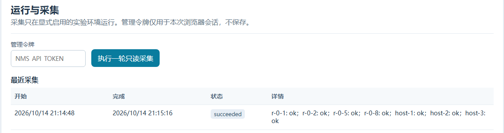

图 18：截图中的输入框未填真实令牌，最近一轮仍为历史 run 9；截图只读，没有点击采集。实际操作时，在“管理令牌”输入框填 DEV 的值，再点击“执行一轮只读采集”。

等待采集结束，检查新增运行编号、时间及每个目标的结果。完整结束后再执行下一轮，为速率计算取得相邻计数样本。真实数据的主机选择 `host-1` 等，接口以实际下拉选项为准；`sample-host-1` 属于本地练习。

### 12.3 路线 B：从源码启动自己的 live 后台

**运行后台的机器本身必须能访问课程内网**。仅通过 SSH 转发打开远程网页，不会自动让本机 Python 的 SNMP 和 ping 接入课程内网。普通同学电脑需要使用已有 DEV 时，选择路线 A。

在具备实验内网访问条件的 Linux / WSL / DEV 上，准备本仓库源码与 Python 依赖，进入 `project` 目录。缺少 pip 或外网下载条件的 DEV，按仓库部署文档准备离线依赖。

第一步，保留现有配置文件；没有 `.env` 时才复制模板：

```bash
test -e .env || cp .env.example .env
```

第二步，用编辑器修改 `.env`，写入或合并以下内容。SNMP 使用本组已实测可读的 `public`；是否为课程正式指定凭据仍待确认：

```dotenv
NMS_ENABLE_LIVE=1
NMS_SNMP_COMMUNITY=public
NMS_POLL_INTERVAL=0
NMS_ENABLE_SERVICE_PROBE=0
NMS_ENABLE_IPERF3=0
```

继续执行以下命令：保留 `.env` 中已有的管理令牌，没有时自动生成并保存。输出用于自己新启动的后台，不会改变已有 DEV 的管理令牌：

```bash
python3 - <<'PY'
from dotenv import dotenv_values, set_key
from secrets import token_urlsafe

token = dotenv_values('.env').get('NMS_API_TOKEN') or token_urlsafe(32)
set_key('.env', 'NMS_API_TOKEN', token)
print('本后台管理令牌：', token)
PY
```

第三步，启动 live；WSL 源码在 `/mnt/c` 时，推荐将实验库放在 Linux 用户目录，方便以后创建权限合格的迁移备份：

```bash
NMS_DB="$HOME/.local/share/nms-team2/live.sqlite3" \
  python3 run.py --mode live --port 8002
```

保持终端运行，打开 **http://127.0.0.1:8002/**。这条命令不会装载样例。全新库最初只有课程文档候选，接口和实际历史在采集成功后出现。

第四步，在另一个终端检查：

```bash
curl --noproxy '*' --fail http://127.0.0.1:8002/api/v1/health
```

| 字段 | 预期含义 |
|---|---|
| database = ok | 当前实验库可读取 |
| live_enabled = true | 允许执行登记目标的真实采集 |
| snmp_configured = true | 已提供 community；是否正确仍需实际设备响应确认 |
| poll_interval_s = 0 | 按本教程手动采集，后台不周期执行 |
| service_probe_enabled = false | 尚未启用真实端口探测 |
| iperf3_enabled = false | 尚未启用真实吞吐量任务 |

第五步，将自己 `.env` 中的管理令牌填入网页，然后连续执行采集并核对结果。真实数据的时间和数值取决于实测情况，不使用第 7 节样例的固定日期与 125/250 byte 结果。

启动器自动读取 `project/.env`；终端已设置的同名环境变量优先，命令行 `--db` 优先于 `NMS_DB`。`--mode live`、`NMS_ENABLE_LIVE=1`、网络可达和正确凭据分别承担不同作用，需要同时满足采集条件。

### 12.4 已有 DEV 服务怎样启动或重启

以下命令在**已经登录 DEV 的终端**执行，用于已完成 systemd 部署的机器：

```bash
sudo systemctl status --no-pager nms-team2
sudo systemctl start nms-team2
```

DEV 维护者修改 `/etc/nms-team2/nms.env` 后，执行：

```bash
sudo systemctl restart nms-team2
```

| 运行方式 | 读取的配置 | 数据位置 |
|---|---|---|
| 本机或源码目录运行 run.py | 该项目的 `.env` 和终端环境变量 | `NMS_DB` 或 `--db` 指定的实验库 |
| DEV systemd 服务 | `/etc/nms-team2/nms.env` | `/var/lib/nms-team2/nms.sqlite3` |
| 本机 SSH 端口转发 | 本机 SSH 登录/代理配置 | 直接访问远端服务的数据 |

修改自己电脑的 `.env` 不会修改 DEV 服务。新机器的首次安装与升级，按本仓库 `project/deploy/README.md` 执行；无需重复安装已经部署好的 DEV。

### 12.5 怎样判断测到了本轮真实数据

1. 查看“最近采集”，确认编号与完成时间新增，而非仅仅刷新旧记录。
2. 查看目标级结果，成功、失败和部分读取分别判断；运行完成不能代替每台设备采集成功。
3. 在 ping、接口计数与速率记录中核对 `live` 来源和本轮采样时间。
4. 取得连续有效计数后再看速率。久未采集后的第一条可能是 sample_gap；真实空闲接口也可能得到有效的零速率。
5. 计费窗口覆盖实际有效区间，CSV 与页面一致。若包含未采样时间，查看覆盖率与缺口，不对缺失部分外推。

### 12.6 live 下仍须分别开启的功能

| 功能 | 所需条件 |
|---|---|
| 接口、路由、流量计数和方向速率 | 后台能到达设备，live 开启，community 可读，采样满足计算条件 |
| DEV 到测试主机的延迟与丢包 | live 开启、ping 工具和网络通路 |
| 确认故障、确认风险、保存基线 | 当前后台的管理令牌 |
| 端口检查 | 额外开启 NMS_ENABLE_SERVICE_PROBE，目标与端口基线已配置 |
| iperf3 真实任务 | 额外开启 NMS_ENABLE_IPERF3，服务账户到两端的 SSH 认证与固定主机密钥、所需工具均就绪 |

两端 SSH 配置在 DEV 服务账户上统一完成；访问网页的同学电脑只需配置本机到 DEV 的通路。10 月 15 日的失败任务保留为历史；10 月 17 日已配置前两台主机并成功从网页完成一次真实测试，当前 DEV 已启用 iperf3。第 12.3 节自建后台示例仍默认关闭，需自行满足前置条件后开启。

### 12.7 live 启动与访问排障

| 现象 | 处理方向 |
|---|---|
| SSH 超时或无 IPv6 通路 | 检查课程入口及自己已经验证的代理配置；裸 SSH 示例不含 WARP/SOCKS5 配置 |
| 本机端口已占用 | 继续使用现有正确转发，或换本机端口；保持远程端口 8000 |
| 页面可开，但显示历史时间 | 当前未做新采集或自动轮询为 0；先填当前后台令牌再采集 |
| 改了 .env 仍没变化 | 核对访问的是自己的源码服务还是 DEV systemd 服务，以及终端变量优先级 |
| live 开启，但 SNMP 超时 | 后台到内网的实际路由、设备响应及 community；网页 SSH 转发本身不提供 SNMP 通路 |
| 管理操作 401 | 当前页面令牌与当前后台不匹配；真实 DEV 不使用教程样例令牌 |
| 真实接口没有 100/200 bit/s | 样例的固定数值只用于练习；真实结果按计数差和时间计算 |
| iperf3 在 SSH 就绪前失败 | 补齐 DEV 服务账户的两端 SSH 条件，配置与授权由维护者处理 |

完成标准：清楚当前访问哪个后台、配置来自哪里，能核对新增运行及 live 样本；分别记录不可达、缺权限和功能未启用，避免把样例或历史数据写成本轮实测。

## 13. 新增 IP 探测、诊断与流量归属

本节对应 0.3.0 / schema v3。原样例文件保留，新版默认使用 `demo-v3.sqlite3` / `local-test-v3.sqlite3`。下列截图均为实际本地 sample 操作；新增功能的实测状态见[验收说明](差距补齐与验收说明.md)。

### 13.1 查看接口 IP 和实测关系

“配置管理”新增接口 IP/掩码、子网、采样时间和地址表读取状态。空表、截断或失败会明确标记，不按“设备没有地址”处理。

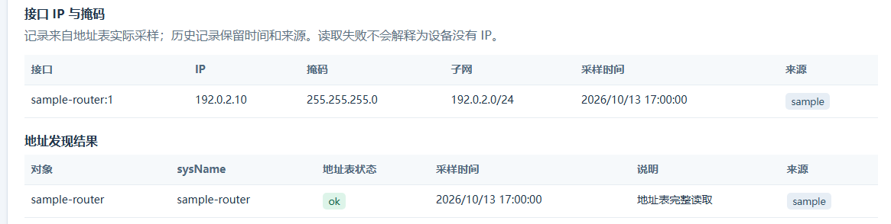

展开“逻辑拓扑与快照”：实线表示采样子网归属，虚线表示课程文档关系，鼠标悬停可查看依据与时间。实测逻辑关系不证明物理直连，候选设备也不会仅因名字相同而合并。

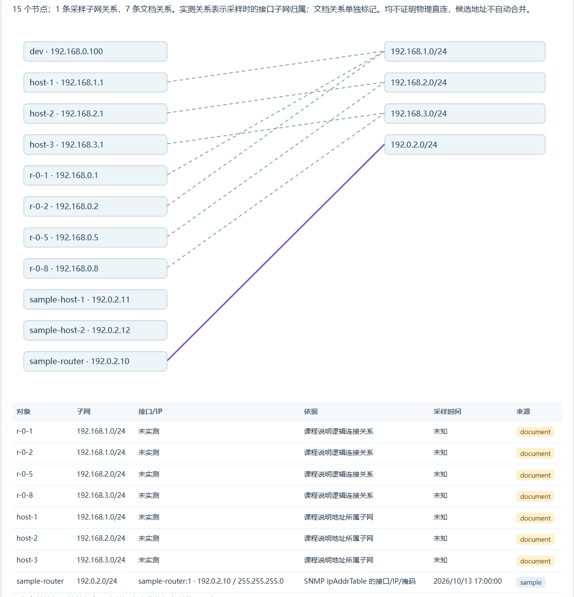

### 13.2 查看诊断依据

在“故障管理”选择设备，下方诊断区域解释最近的 ping/接口观测并给出建议。超过 5 分钟的样本标为历史，查询失败保留未知；关联异常接口只是排查线索。


### 13.3 流量归属与网元对测试统计

沿用第 7 节窗口点击“统计流量”，接口结果会补充设备、子网和方向；旧映射、窗口内变化或不完整时不做单一子网归属。下面另显示成功 iperf3 任务的客户端→服务端、接收字节、任务 ID 和来源，支持独立 CSV。

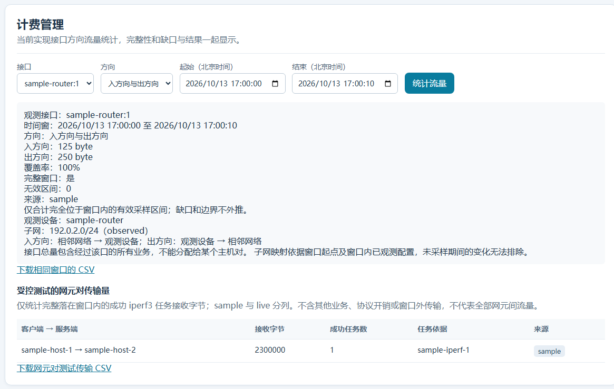

图中接口总量为 125/250 byte，测试网元对接收字节为 2,300,000；两者范围不同，不应相加。后者只统计完整落在窗口内的成功测试任务，不代表所有业务流量。样例与 live 分列，失败和跨窗口任务不纳入。

### 13.4 新增安全规则

实际成功 SNMP 读取后，系统评估常见默认团体字访问风险，证据不保存团体字值；已配置基线的 TCP/23 开放则提示核实潜在 Telnet 管理服务。与既有基线偏差、高利用率规则一起显示于风险表。配置和端口线索未进行漏洞利用或攻击源确认。

### 13.5 新版 DEV 的真实操作结果

以下为 2026-10-17 的真实截图。四个路由候选共读到 27 条地址记录，图中有 23 条采样子网关系；文档连接单独标记。

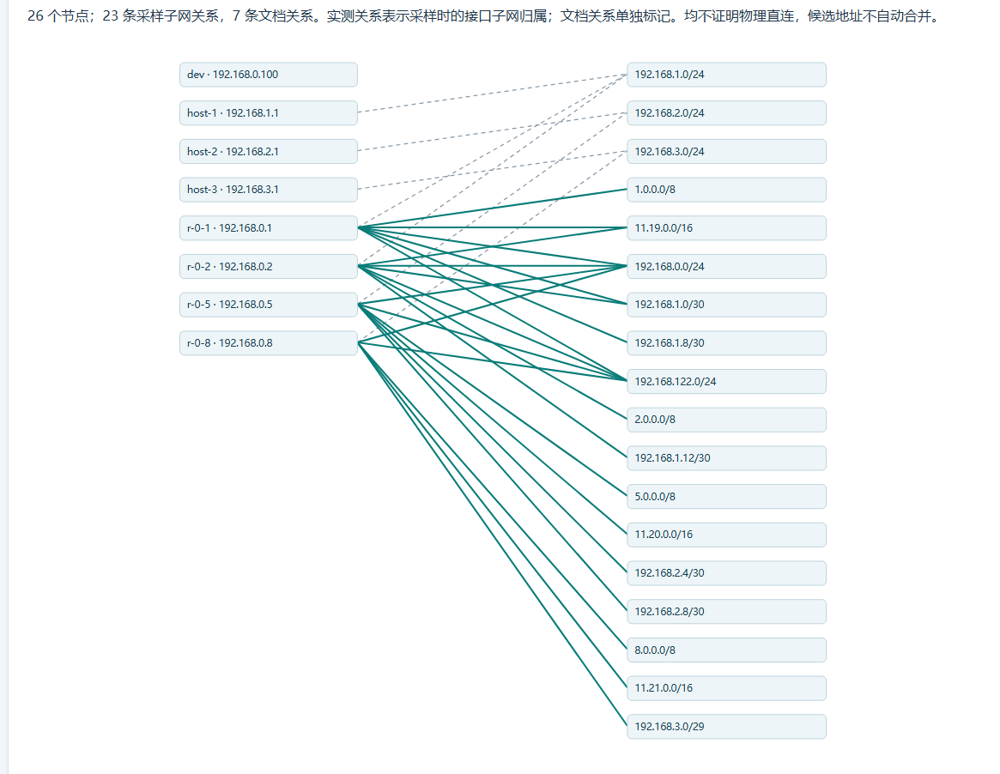

网页实际提交一次 host-1→host-2、2 秒/10 Mbit/s 的任务，接收 2,486,216 byte、约 9.94 Mbit/s。两端受限认证配置在 DEV，访问网页的电脑不需要复制私钥。

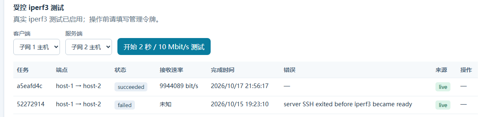

同一 46 秒观测窗口中，r-0-1:3 入 1,006,844、出 3,502,466 byte，覆盖率 100%；下方测试网元对接收字节为 2,486,216。接口总量包含背景及管理流量，不能等同测试业务。

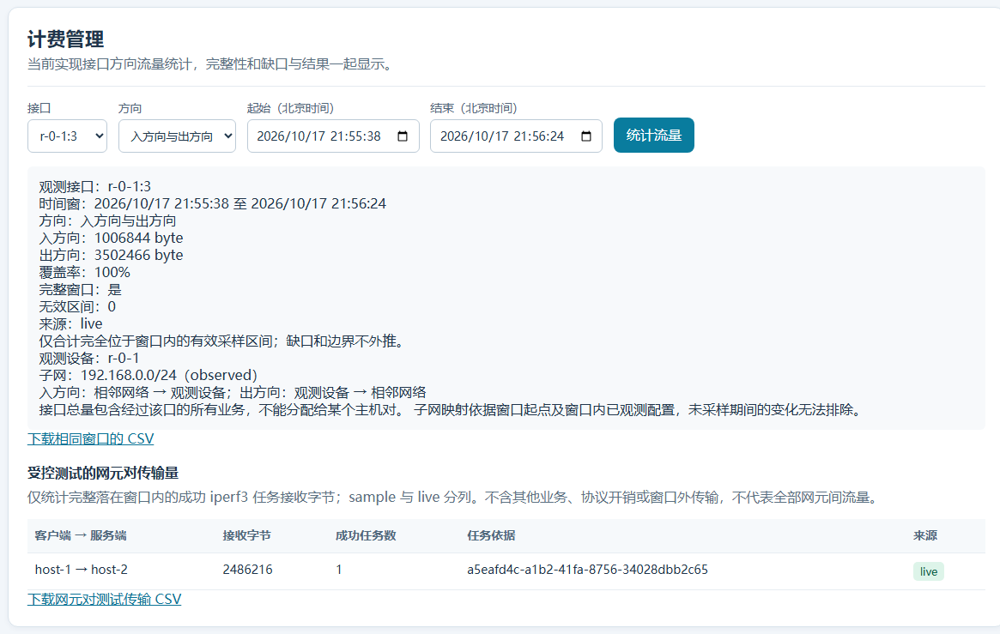

只读 SNMP 查询还形成默认访问配置风险线索。下图的一条真实记录已从网页确认；未更改管理凭据或制造漏洞，确认状态不代表风险已经修复。

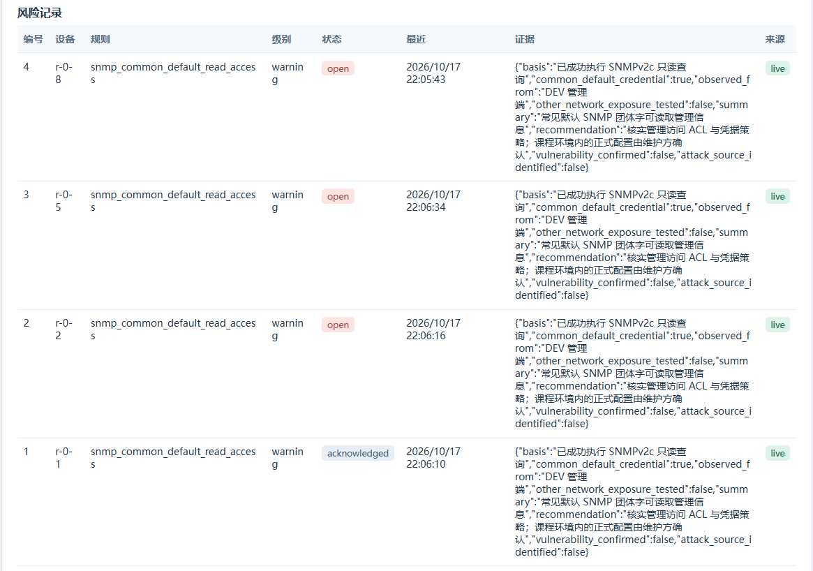

截至本节，全部主机对的其他业务流量、物理直连/身份、自然变化与恢复、课程验收口径仍有待补充。详见[逐项要求对照](课程要求逐项对照.md)。

### 13.6 周期采集

当前 DEV 每轮采集结束等待 15 秒后继续，实际间隔还包含约 25～28 秒的采集耗时。两轮自动采集已通过并形成有效速率样本；浏览器关闭不会停止 DEV 后台。需要看新数据时点击“刷新数据”。接口基线例子及本机自建命令仍保留手动采集配置，按对应后台的 health 判断实际开关。
