# 网络管理系统图文使用教程

第 2 组课程设计 · 更新：2026-10-22（新增一键启动；页面截图拍摄于 10 月 20 日）

本教程对应新版功能视图。**全部截图为 2026-10-20 从本机入口只读访问 DEV 的实际页面**；截图里的任务、告警和风险是数据库中已有记录，截图过程未触发新的吞吐量测试、端口检查或告警确认。数字会随后台采样变化。页面时间统一为北京时间（UTC+8），数据库保存 UTC。

可以阅读本文，或打开同目录的 [独立 HTML](图文使用教程.html) / [PDF](图文使用教程.pdf)。HTML 已嵌入全部截图，可单独复制并离线阅读，点击图片可放大。操作速查见 [使用说明](使用说明.md)。

## 1. 我们要做什么，先从哪里看

这个系统用于管理老师提供的实验网络：采集设备与接口信息，保存历史，计算网络性能与流量，发现异常并记录处理过程。

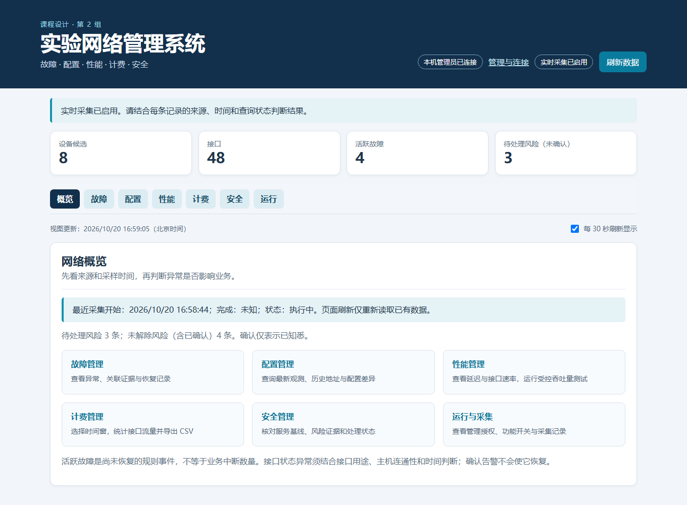

首页只保留概览和功能入口。点击顶部导航或卡片切换视图，浏览器后退也可以返回；切换功能不会清空本页已填写的表单。点击某条告警的详情链接才会进入另一张页面。

| 功能入口 | 用来回答的问题 | 首次建议操作 |
|---|---|---|
| 故障 | 什么对象异常，证据是什么，是否恢复？ | 看告警对象，点“查看详情” |
| 配置 | 有哪些接口、地址、路由，配置发生什么变化？ | 看最新地址和采样状态，再比较快照 |
| 性能 | 延迟、丢包、接口速率怎么样？ | 选主机和接口看趋势 |
| 计费 | 指定时间经过接口的流量是多少？ | 选时间窗并统计，检查覆盖率 |
| 安全 | 哪些观测偏离预期，哪些风险需要核查？ | 看风险证据和服务基线 |
| 运行 | 如何授权，后台有没有在采集？ | 看管理状态和最近采集记录 |

“设备候选”不是物理设备数量。“活跃故障”不是业务中断数量。“待处理风险”只数未确认记录；概览另列出包含已确认记录的“未解除风险”。

## 2. 先选真实环境还是本地练习

### 当前这台电脑访问真实 DEV

**推荐：在 Windows 文件资源管理器打开 `C:\Myfiles\Mycode\2026\计网管`，双击 `一键打开网络管理网页.cmd`。** `大作业\project` 中的 `一键打开真实网页.cmd` 也可以使用。

启动器会复用正常连接，或按现有 WARP 代理配置重新建立通路，检查管理员授权后自动打开浏览器。成功后可关闭启动窗口；重启电脑后再次双击即可，不需要另开 WSL 运行 Python。错误时窗口会保留提示，排障方法见 [使用说明的一键启动章节](使用说明.md#一键打开真实网页)。本机连接文件和加密凭据是前置条件，其他电脑先按第 12 节配置。

也可以沿用原来的手动方式：打开已配置的 WARP，在 PowerShell 执行：

```powershell
powershell.exe -NoProfile -ExecutionPolicy Bypass -File "C:\Myfiles\Mycode\2026\计网管\大作业\project\deploy\start_windows_loopback_tunnel.ps1" -UseCoursePassword -Detached
```

浏览器打开 **http://127.0.0.1:8000/**。这条脚本是维护者本机配置，不随公共仓库发布。它打开本机访问通路，Python 后台仍在 DEV 上运行。本机关闭网页或关机，不会停止 DEV 后台。其他电脑的方法见第 12 节。

### 本地样例练习

在 Ubuntu WSL / Bash 中，从仓库根目录进入 `project`（已经在该目录就不必再 `cd`）：

```bash
cd project
python3 -m venv .venv
source .venv/bin/activate
python -m pip install -r requirements.txt
NMS_API_TOKEN=local-test-only python3 run.py --mode local --port 8001
```

打开 **http://127.0.0.1:8001/**，保持终端运行，退出时按 `Ctrl+C`。`local-test-only` 仅为本地练习令牌。在“运行 → 管理令牌”输入这个值后，能确认样例告警、确认风险和保存基线；真实网络功能关闭。

| 模式 | 数据和操作 |
|---|---|
| demo | 构造样例，只读展示，管理写入关闭 |
| local | 独立样例库，可确认记录和保存基线；不进行真实测量 |
| live | 不载入样例，依赖实验网连通性、SNMP 和各项功能开关 |

8000 和 8001 的区别来自它们连接的服务与启动配置，端口号本身不决定真假。本机 8000 目前连接 DEV，8001 用于本地练习。

## 3. 授权、刷新和数据来源怎么看

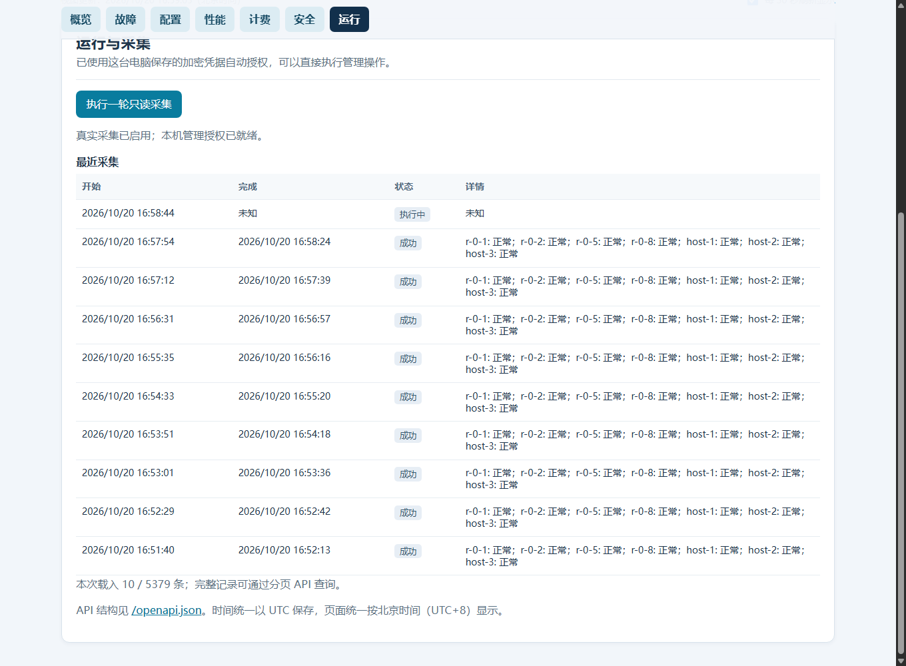

当前电脑显示 **“本机管理员已连接”** 时可以直接执行管理操作，主页和详情页不需要输入令牌。本机凭据存放在 `%LOCALAPPDATA%\NMS-Team2\admin-token.dpapi`，由当前 Windows 账户加密保护；本机网关解密并附加授权，浏览器不取得真实令牌。

其他电脑、直接 SSH 转发或本地样例通常显示“手动管理授权”：点击顶部“管理与连接”，进入“运行”，填写该后台的 `NMS_API_TOKEN`。手动令牌仅留在当前文档内；切换功能保留，整页刷新、进入详情或重开网页后需重新填写。若通过本机加密入口，则这些情况会自动重新检查授权。

- **刷新数据**：读取已经保存的数据，不启动网络测量。
- **每 30 秒刷新显示**：默认开启；页面在后台、正在编辑输入框/下拉框或上一轮读取未完成时会跳过。可取消勾选后手动刷新。
- **视图更新时间**：这次页面读取的时间；不等于设备采样时间。
- **最近采集轮次及每行采样时间**：判断数据新旧的依据。实时开关开启也不保证每一目标都采样成功。
- 自动刷新保留当前筛选、手动输入和已经完成的快照比较；比较结果对应已选快照，不会自动变成新的比较。

| 页面中文标记 | API 原值 | 含义 |
|---|---|---|
| 真实采集 | live | 实际执行过，但结果仍可能超时或失败 |
| 演示样例 | sample | 构造数据，不能作为实验结果 |
| 课程文档 | document | 文档候选清单或逻辑关系 |
| 手动配置 | configured | 人工设定的预期基线 |

## 4. 故障：从摘要进入证据页面

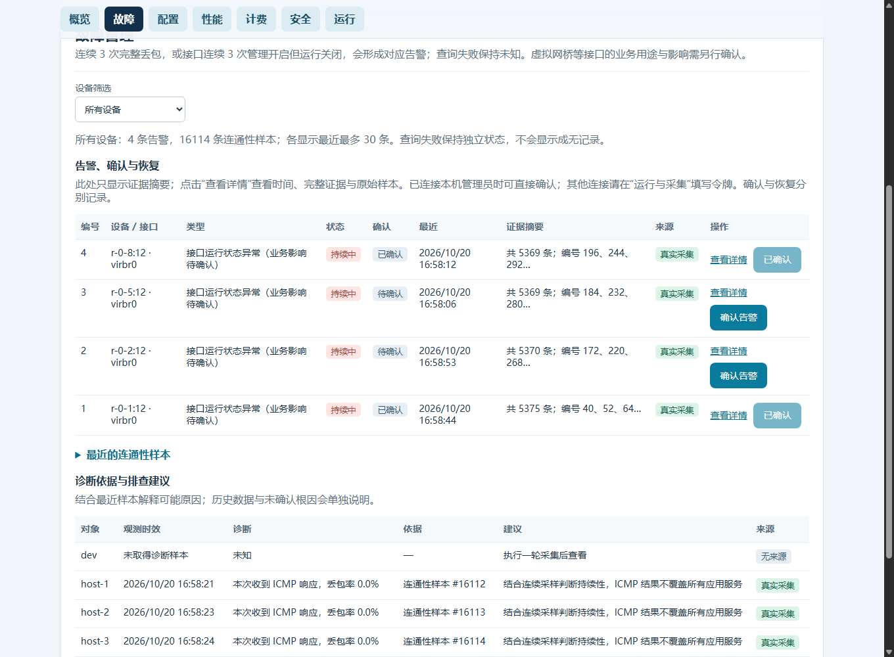

1. 点击“故障”，按需要选择设备。
2. 先看对象、异常类型、状态和最近时间，再点“查看详情”。
3. 需要查看连通性样本时，展开“最近的连通性样本”；长表每页 10 行。
4. 阅读下方诊断依据和建议。它们是排查线索，不能直接认定根因。

故障规则包括：连续 3 次完整丢包，以及接口连续 3 次“管理开启、运行关闭”。查询失败保持未知，不当作 100% 丢包。

实测告警涉及 `virbr0`。页面会显示当前接口名称及“业务影响待确认”：虚拟网桥是否承载课程业务，仍需结合配置确认。界面没有自动忽略、解除这些告警，也没有把它们标成业务中断。

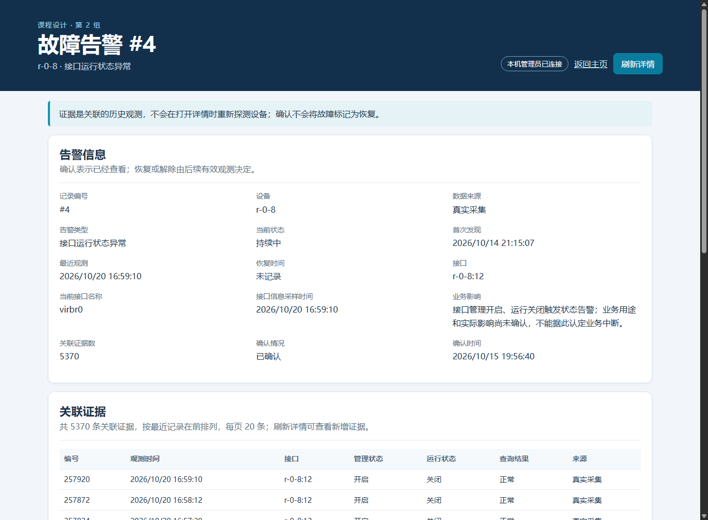

详情包括首次发现、最近观测、恢复与确认时间、当前接口信息和业务影响提示。接口名称附有采样时间，它不一定等于历史事件发生时的名称。

证据每页 20 条，使用“上一页/下一页”查看关联的原始 ping 或接口状态样本。打开详情、翻页和“刷新详情”均只读。**“确认故障告警”只记录已知悉，不会让持续中的故障恢复。**

## 5. 配置：最新观测与历史分开看

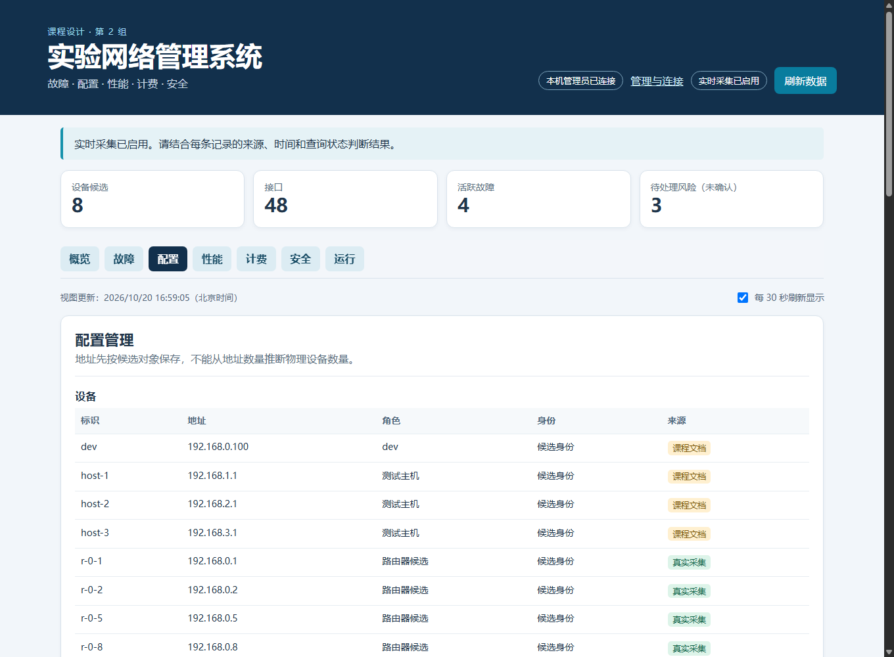

点击“配置”，依次查看设备候选、接口、地址和路由。表格超过 10 行时翻页；不要把第一页当成完整清单。接口管理/运行状态分列在同一单元格，参考速率未知时显示“未知”。

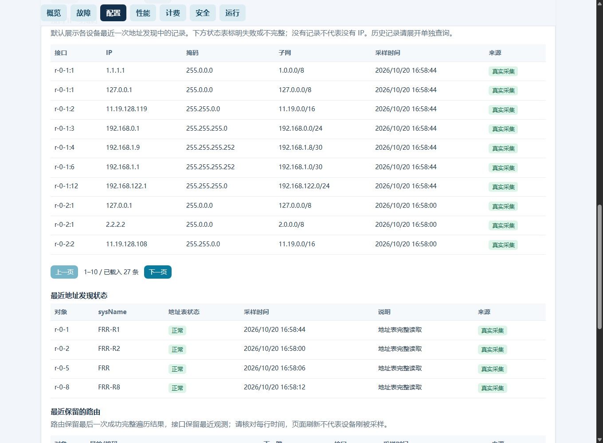

**接口 IP 与掩码**只显示每设备最近一次地址发现取得的记录，避免历史重复地址堆满页面。必须结合紧接着的“最近地址发现状态”解释：

- 最近尝试成功：展示当次取得的地址。
- 最近尝试不完整：只展示实际取得的部分，状态和说明保留。
- 最近尝试失败且没有行：不会自动用旧成功记录填充；不能据此断言设备没有 IP。

接口是最近保存的观测；路由保留最后一次成功完整遍历的结果。请逐行看采样时间，过期结果不会因为页面刷新而变新。

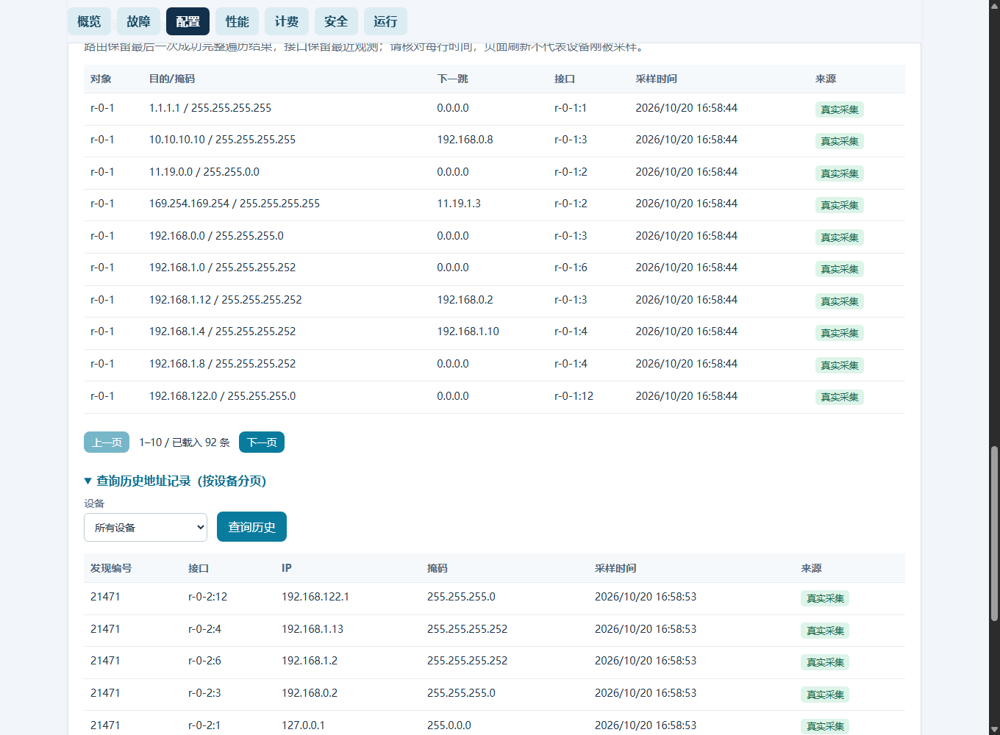

展开“查询历史地址记录”，选择设备，再点击“查询历史”。每页 10 条，翻页可以继续查询服务器上的历史。发现编号用于辨认同一轮地址采样。自动刷新不移动当前历史页。

## 6. 配置快照和逻辑拓扑

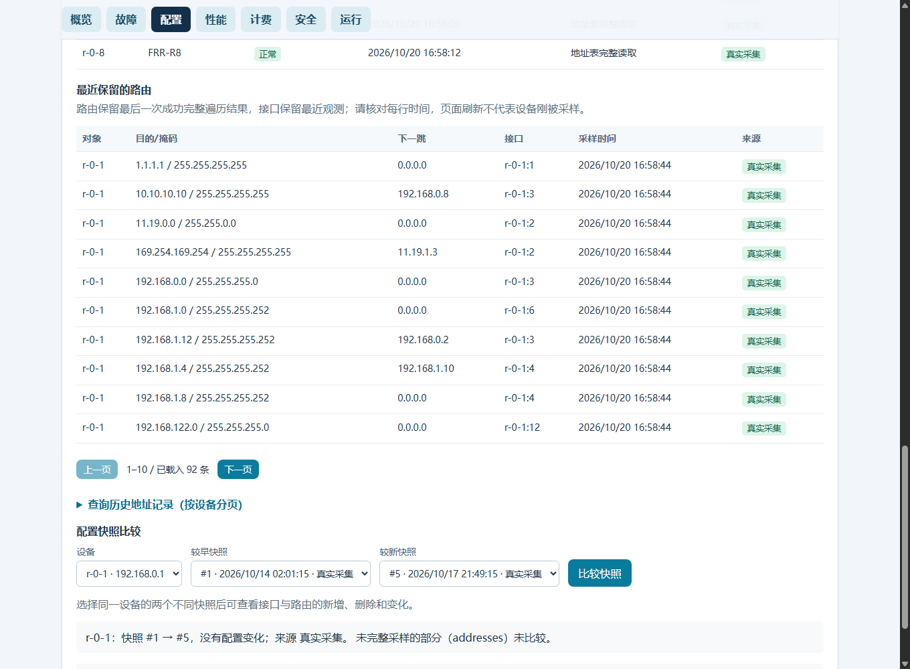

1. 在“配置快照比较”选择设备。
2. 选择两份不同快照，注意时间与编号。
3. 点击“比较快照”，查看接口、路由和地址的新增、删除或变化。
4. 若采样不完整，对应部分会提示未比较；没有变化也是有效结果。

比较查询不修改实际设备。自动刷新会保留当前比较；想重新取得快照选择列表时，点击顶部“刷新数据”。选择列表最多载入最近 500 份，完整历史可通过 API 分页查询。

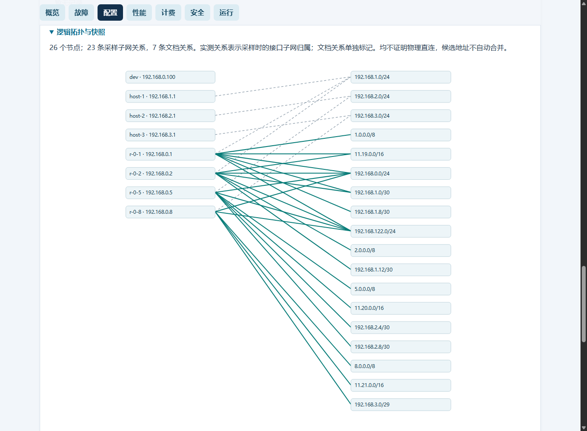

展开“逻辑拓扑与快照”。课程文档关系与 SNMP 地址表关系分别标注来源；接口处于同一子网不证明物理直连。地址候选也可能属于同一实际设备，不应按候选数量推算物理路由器数量。

## 7. 性能：看延迟、丢包和接口速率

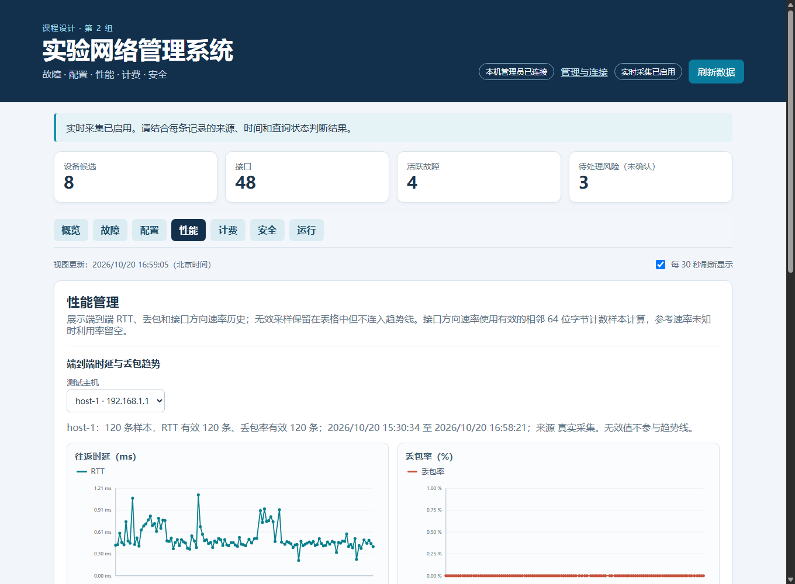

点击“性能”，选择测试主机。RTT 是 DEV 对所选主机的往返时延；丢包率与查询状态一起解释。空缺或查询失败不会画成 0。需要看原值时展开“端到端样本明细”。


初次打开时优先选运行中的非回环、非常见虚拟候选接口，避免直接默认到 `lo`。默认只是便于观察的选择，不代表系统已确认业务角色；按课程拓扑选择实际需要观察的接口。

速率来自有效相邻 64 位字节计数差分。计数器复位、查询失败、间隔过长等区间保留无效原因，不连接成正常趋势。入/出方向以选定接口为参照，不能把不同接口的数字随意相加。参考速率未知时，利用率为空也可以是正常情况。

## 8. iperf3：需要主动测量时再运行

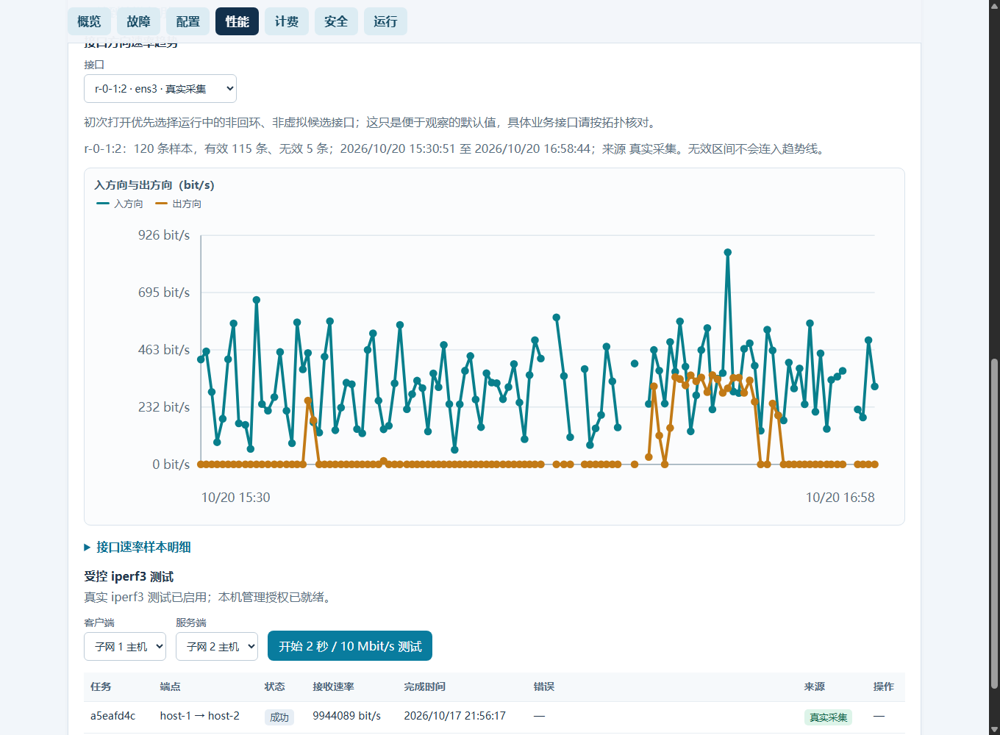

图中任务是已有历史；本次整理截图没有新建任务。

1. 在性能视图下方确认“真实 iperf3 测试已启用”。
2. 选两个不同测试主机。当前 DEV 只允许 `host-1`、`host-2`，`host-3` 未配置专用授权。
3. 点击“开始 2 秒 / 10 Mbit/s 测试”。这一步会实际产生受控流量。
4. 等待任务完成，自动刷新或点击“刷新数据”，查看成功/失败、接收速率及错误。
5. 任务仍在运行时可以取消。失败需看具体错误，不把“未启动服务端”笼统认定为网络环境故障。

网页后台统一使用 DEV 服务账户的专用 SSH 认证和严格主机密钥校验。每位访问网页的组员不需要再向两台内网主机部署一套密钥。管理授权、SSH 和功能开关各自负责不同条件；填令牌不会自动开启测试。

## 9. 计费：选窗口、统计、检查覆盖率

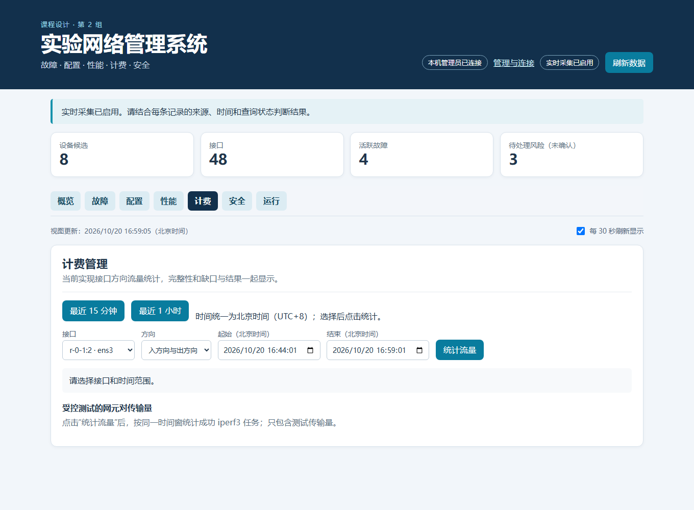

1. 点击“计费”，选接口和方向。
2. 点击“最近 15 分钟”或“最近 1 小时”填入时间，或手动填写。
3. 点击“统计流量”。时间固定按北京时间解释，即使浏览器电脑设为其他时区也一样。
4. 每次快捷按钮只是填时间，不自动提交。结果对应提交时的固定窗口；自动刷新不会滚动窗口或重算结果。

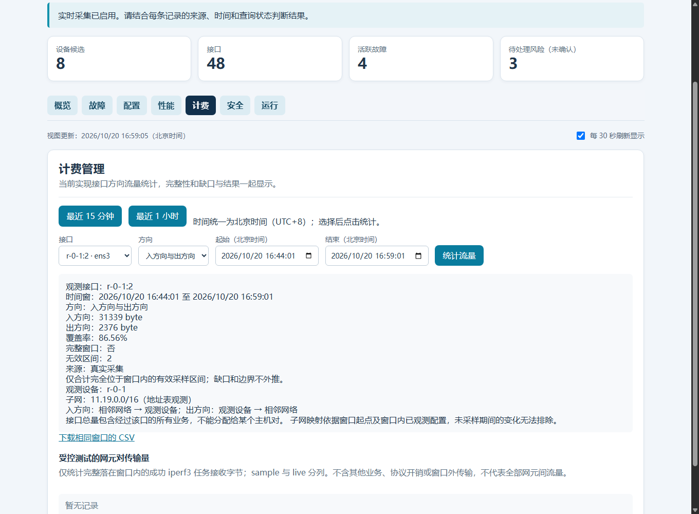

查看入/出字节、覆盖率、完整窗口、无效区间与流量归属，再下载同窗口 CSV。只累计窗口内完整有效区间，不把缺口补成真实流量。

“网元对传输量”只累计成功 iperf3 任务的传输字节；它不是两主机间所有业务流量。系统当前提供流量统计口径，没有配置货币单价或生成收费账单。

本地样例不在当前时间段内：选择 `sample-router:1`，输入北京时间 **2026-10-13 17:00:00 至 17:00:11**，双方向预期入 125、出 250 byte，覆盖率 90.91%，窗口不完整。

## 10. 安全：基线、观测和风险分开理解

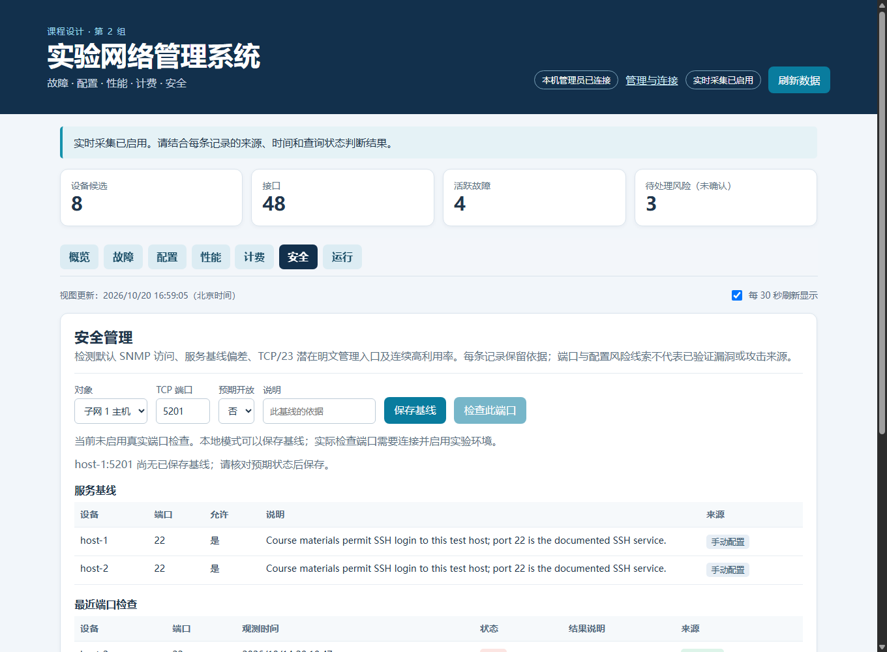

服务基线表示“预期怎样”，端口检查表示“实际观测怎样”。选择设备和 TCP 端口后，表单回填已保存基线。要修改时设置“预期开放”和说明，点击“保存基线”；保存基线本身不探测端口。

当前 DEV 的主动端口探测开关关闭，“检查此端口”会置灰并说明原因。已有观测与风险仍可查看。端口未知不能当成关闭；TCP/23 可连也不能单凭端口号认定已经确认明文服务漏洞。

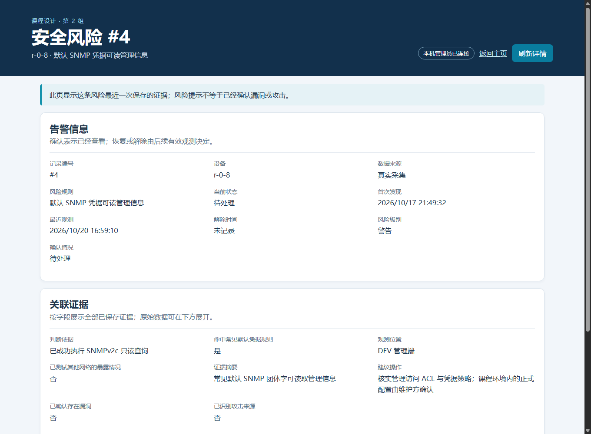

在风险表点击“查看详情”，阅读规则、证据字段和建议，再按需要确认。确认后表示已知悉，仍计入“未解除风险”；后续有效观测满足规则的恢复条件才会解除。

默认 SNMP 凭据可读等提示是风险线索，不代表已经测试所有网络来源的暴露，也不能从这些记录识别攻击源。原始 JSON 放在详情页折叠区，需要核对字段时再展开。

## 11. 用本地样例检查五项功能

这些步骤操作独立 local 样例库，不影响 DEV：

| 步骤 | 预期结果 |
|---|---|
| 运行视图填写 `local-test-only` | 可进行本地管理写入；采集、端口检查和 iperf3 仍关闭 |
| 故障筛选 `sample-host-1`，确认告警 | “已确认”，原有恢复状态保留 |
| 配置快照选择 `sample-router` 比较 | 接口描述变化、新增样例路由 |
| 性能选择样例主机和 `sample-router:1` | RTT/丢包曲线；有效速率入/出 100/200 bit/s |
| 按第 9 节填写样例时间窗 | 125/250 byte，CSV 与页面一致 |
| 安全设置 `host-1` TCP/22 的预期开放与说明 | 保存后表格可见，切换再切回仍回填；不会连接主机 |
| 清空令牌后尝试保存，或填错后重试 | 要求填写或返回 401，不应把保存失败显示为成功 |

样例默认库为 `data/local-test-v3.sqlite3`，修改会保留。要重新练习，可以用 `--db data/practice-round2.sqlite3` 选择一个未使用过的库名。不要用样例库启动 live。

## 12. 其他电脑访问、自己启动 live 与常见问题

### 其他电脑连接现有 DEV

在这台电脑已经能通过 IPv6 或既有代理到达 DEV 的条件下，在终端运行：

```bash
ssh -N -o ExitOnForwardFailure=yes -L 127.0.0.1:18000:127.0.0.1:8000 root@240a:a019::100
```

保持终端运行，打开 **http://127.0.0.1:18000/**。需要代理时使用已验证的 ProxyCommand；只打开 WARP 的 SOCKS5 端口不会让裸 `ssh` 自动使用它。登录口令由组内维护者提供，主机密钥应按已验证记录核对。

这条直接转发需要手动管理令牌。由维护者提供，或维护者登录 DEV 后使用 `sudo less /etc/nms-team2/nms.env` 查看 `NMS_API_TOKEN=`；令牌不要写进仓库或截图。各电脑的 DPAPI 加密凭据需要分别初始化，不能复制本机密文直接通用。

### 自己启动 live 后台

运行 Python 的机器必须能访问课程内网，只有一个网页转发并不等于有内网采集通路。完整准备见 [README 的 live 说明](../README.md#真实环境-live访问与启动) 和 [实验环境配置](实验环境配置.md)。

在 `project/.env` 合并配置，保留已有值，设置自己的 `NMS_API_TOKEN`：

```dotenv
NMS_ENABLE_LIVE=1
NMS_SNMP_COMMUNITY=public
NMS_POLL_INTERVAL=0
NMS_ENABLE_SERVICE_PROBE=0
NMS_ENABLE_IPERF3=0
```

`public` 已实测可读，但是否为正式指定凭据仍待课程方确认。WSL 的 live 数据库放在 Linux 用户目录，便于私有迁移备份：

```bash
NMS_DB="$HOME/.local/share/nms-team2/live.sqlite3" python3 run.py --mode live --port 8002
```

打开 **http://127.0.0.1:8002/**。填自己后台的令牌后在运行视图执行采集；`NMS_POLL_INTERVAL=0` 不自动采集。DEV 现有 systemd 服务读取 `/etc/nms-team2/nms.env`，本机 `.env` 的修改不影响它。

| 现象 | 如何处理 |
|---|---|
| 更新后仍是旧页面 | 按 `Ctrl+Shift+R` 强制重新加载静态资源 |
| 本机 8000 打不开 | 双击一键启动器，查看错误提示；检查 WARP、端口占用和 DEV 服务 |
| 本机授权暂不可用 | 检查 DEV 连接；令牌变更时更新本机加密凭据后重连 |
| 401 | 手动方式核对同一后台令牌；自动方式检查加密凭据是否过期 |
| 503 或按钮禁用 | 看具体原因：服务未配置管理令牌、功能开关关闭或前置条件不满足 |
| 实时已启用但数字不变 | 查看采样时间与轮次状态；页面刷新和后台采样是两个动作 |
| 自动刷新暂时没发生 | 检查勾选、标签页是否前台、输入框是否仍在编辑；也可手动刷新 |
| 统计为空或覆盖率低 | 确认接口、时间窗和来源；刚重启或采样间断会留下无效区间 |
| 数据库迁移提示权限不足 | 将旧实验库移到支持私有权限的 Linux 文件系统按迁移流程处理，不删除原库 |

## 13. 手机查看与目前边界

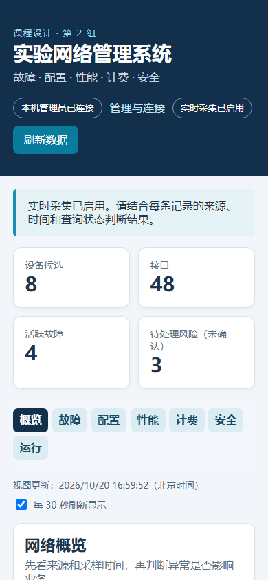

窄屏下可切换各功能；宽表在自身区域横向滚动，页面不应整体溢出。长表默认分页，详情证据另有分页。

目前仍需人工核实接口业务用途、候选设备实际身份及 SNMP 正式凭据。这次更新改善显示与操作，没有把这些待确认项改成“已验证”。既有告警与风险证据保留；图中时间、数量与任务结果以各自记录为准。
