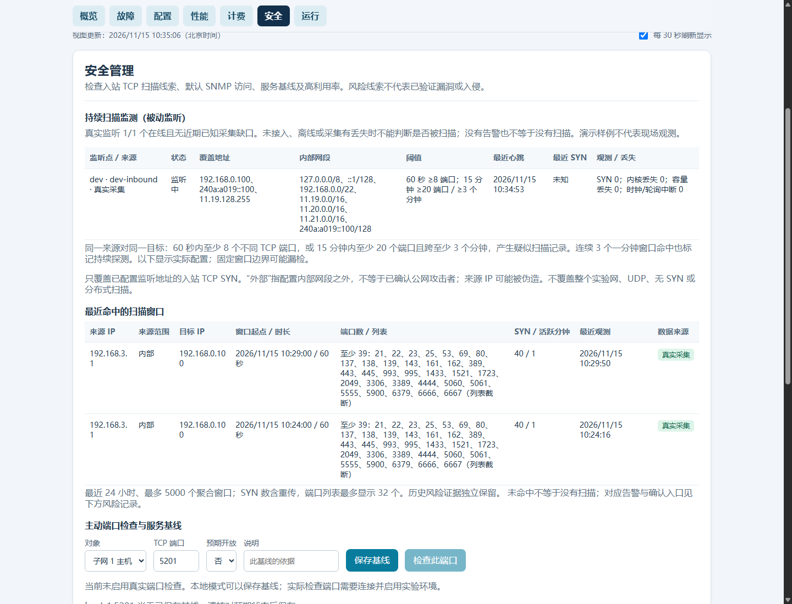

# 被动扫描监测（0.4.0 / schema v4）

安全页新增“持续扫描监测”。它监听已经到达指定本机地址的 TCP 连接尝试，判断是否存在短时间探测多个端口或较慢的持续探测。它不会主动扫描对方，也不会自动封禁来源。

## 在网页上怎么看

1. 打开“安全”，先看监听点状态、覆盖地址、最近心跳和采集丢失计数。
2. “最近命中的扫描窗口”列出观测到的来源 IP、来源范围、目标 IP、端口、窗口时间及数据来源。
3. 下方“风险记录”出现“入站 TCP 端口扫描线索”时，进入详情查看证据；“确认已知悉”仅表示有人处理，不代表扫描停止。
4. 页面默认每 30 秒刷新，也可以手动刷新；监听进程约每 5 秒提交一次窗口与心跳。

“尚未接入”“心跳过期”“监听失败”都表示不能判断当前是否被扫描。“监听中且没有记录”仅表示所覆盖地址上没有命中当前规则，不代表没有任何探测。

## 判定规则

按**监听点、来源 IP、目标 IP**分别统计不同目的 TCP 端口，使用 UTC 对齐的固定时间窗：

| 规则 | 默认条件 | 含义 |
| --- | --- | --- |
| 快速端口探测 | 60 秒内至少 8 个不同端口 | 疑似端口扫描 |
| 连续快速探测 | 连续 3 个一分钟窗口分别满足快速规则 | 持续探测线索 |
| 较慢持续探测 | 15 分钟内至少 20 个不同端口，且分布在至少 3 个不同分钟 | 持续探测线索 |

只计算 SYN 已置位且 ACK、RST、FIN 未置位的 TCP 包。SYN 重传可能增加包数，但同一窗口同一目的端口只计一次，不会仅靠重复访问 SSH 一个端口触发多端口规则。这里不验证握手成功、端口开放或访问被拒绝。

固定窗口边界可能拆散探测；低于阈值、UDP、无 SYN、分布式来源、分片或不支持的 IPv6 扩展头可能漏检。正常授权扫描、运维盘点和 NAT 后的多用户访问也可能命中，需要结合现场日志核实。

## 覆盖范围与“外部”的含义

默认部署在 DEV，**只观察配置列出的本机地址**。它看不到未经过 DEV 的路由器和其他测试主机之间的连接。要覆盖其他设备，需要在那里部署合适的监听点，或取得网关/防火墙/镜像口的连接记录，不能把一个 DEV 监听点称为全网入侵检测。

`NMS_SCAN_INTERNAL_CIDRS` 定义内部范围；范围内来源显示“内部”，范围外显示“配置网段外”。未配置范围时，非回环来源显示“未确认”。不要根据私网/公网地址形式直接猜测来源性质：实验环境也使用看起来像公网的地址。

**来源 IP 是包头中观测到的地址，不是已经确认的攻击者身份**。它可能经过 NAT，也可能被伪造。命中规则不证明存在漏洞或已经被入侵。

## 记录、状态与资源限制

- 聚合窗口保留最近 24 小时且全库最多 5000 行；风险记录另外保存证据，不依赖窗口明细永远存在。
- 每个进程最多跟踪 4096 个窗口分组，每组最多保留 256 个不同端口；网页端口列表最多 32 个。截断时明确标注，端口数按“至少”解释。
- 心跳超过 30 秒标为过期。内核丢包、容量不足或轮询/时钟中断标为采集缺口，不能用来推断安全。
- 数据库被其他采集任务写入时，监听器不阻塞收包：保留有界内存窗口并稍后重试保存，累计 `persistence_retries`。长期无法保存仍会表现为页面心跳过期，不能宣称数据实时完整。
- 连续健康观测至少 300 秒，且该来源/目标至少 300 秒未再命中阈值时，旧风险解除；含义是“未再命中规则”，不是“漏洞已修复”。启动、重启或缺口后重新累计健康观测时间。
- 只保存地址、端口、时间和计数等元数据，不保存完整数据包或业务内容。运行服务不进入混杂模式，不改防火墙规则。
- socket 上附加并锁定内核 BPF 过滤器，普通 TCP 数据、UDP 等无关流量不进入用户态队列；支持的 IPv6 扩展头交给有界解析器继续检查。即便如此仍显示内核丢失数，不能承诺高负载下零丢失。实现依据见 [Linux Socket Filtering](https://docs.kernel.org/networking/filter.html)。

## Linux 部署

先按 [部署说明](../deploy/README.md)更新主服务到 0.4.0，数据库会在备份后升级为 schema v4。普通 Windows 网页/演示仍可运行，但被动监听进程需要 Linux；它是独立服务，不给网页后端增加抓包权限。

在部署目录已有新发布包文件的前提下：

```bash
ip -j address show
sudo install -o root -g root -m 0600 /opt/nms-team2/scan.env.example /etc/nms-team2/scan.env
# 编辑 scan.env：逐项核实本机目标地址、内部网段、设备 ID 和监听点 ID。
sudoedit /etc/nms-team2/scan.env
sudo install -o root -g root -m 0644 /opt/nms-team2/nms-scan-sensor.service /etc/systemd/system/nms-scan-sensor.service
sudo systemctl daemon-reload
sudo systemctl enable --now nms-scan-sensor
sudo systemctl status --no-pager nms-scan-sensor
curl --fail http://127.0.0.1:8000/api/v1/security/scan-status
```

`NMS_SCAN_TARGETS` 必须是所选接口实际存在的本机地址；地址消失时监听报错，不能继续声称覆盖。监听点 ID 应唯一，进程锁避免同一 ID 同时启动两个实例。配置文件不需要网页管理令牌。

独立服务以 `nms-team2` 用户运行，仅授予 `CAP_NET_RAW`，限制写目录、内存及 CPU。Linux packet socket 的权限与收包语义参考 [packet(7)](https://man7.org/linux/man-pages/man7/packet.7.html)；服务隔离配置参考 [systemd.exec](https://www.freedesktop.org/software/systemd/man/latest/systemd.exec.html)。这些权限支持捕获，不代表能看到交换网络上的所有流量。

关闭监听可执行 `sudo systemctl disable --now nms-scan-sensor`，网页随后显示停止/心跳过期，已有风险保留。后续更新或回退主服务时，也应核对监听代码、unit 与数据库版本；主服务的停止/重启通过 `PartOf` 关联监听服务。

## API 与验证

- `GET /api/v1/security/scan-status`：监听范围、实际阈值、状态、心跳、累计计数及缺口。
- `GET /api/v1/security/scan-windows?matched=true&limit=30`：命中窗口；支持 `sensor_id`、`source_scope=internal|external|unknown`、`matched`、`limit`、`offset`。
- 风险详情与确认沿用 `/api/v1/risks/{id}` 及其授权确认接口，没有公开的伪造观测写入口。

自动测试覆盖正常连接、重传、多端口、连续与较慢探测、窗口隔离、IPv4/IPv6、采集丢失、离线、重启、确认与恢复，以及旧数据库迁移。现场验证使用 DEV 回环地址和独立临时数据库，构造本机连接尝试，不向实验网其他设备发起扫描；该验证属于受控实验，不能当成发现了真实外部攻击。

## 本轮上线与现场记录（2026-11-15）

已部署在 DEV：主服务 0.4.0 / schema v4，独立监听服务以 `nms-team2` 用户运行，只增加 `CAP_NET_RAW`。覆盖地址为 `192.168.0.100`、`240a:a019::100`、`11.19.128.255`。旧代码与 SQLite 备份保存在 `/var/lib/nms-team2/deploy-backups/20261115T022330Z-597093`。

北京时间 **10:24:08～10:24:16** 的真实观测中，来源 `192.168.3.1` 向 `192.168.0.100` 在一分钟窗口内探测了至少 **39 个不同 TCP 端口**，记录了 40 个 SYN，形成风险 #5。按当前配置它属于内部来源；这不是回环验证生成的记录，也不能据此认定为公网攻击或确认操作者。该记录证明多端口探测，是否持续应继续看后续窗口。

初次上线曾报告收包丢失，随后增加并锁定内核过滤器；北京时间 10:29 的复核中，监听心跳持续更新，丢失、容量溢出和轮询中断计数均为 0。这仅是该次复核结果，不是永久零丢失保证。过滤优化备份位于 `/var/lib/nms-team2/deploy-backups/scan-filter-20261115T022829Z`。

验证：最终完整 Python 回归 **120 项通过（22.00 秒）**，含 11 项扫描检测/迁移/接口/写锁竞争测试；四组前端检查通过。独立 DEV 测试库中，IPv4 和 IPv6 回环各 12 个目的端口生成两条风险，累计恰为 24 个 SYN，UDP 未进入统计，监听正常退出且无采集丢失；未向其他实验设备发起测试扫描。最终离线发布包隔离冒烟通过。

原始部署、只读 API 和浏览器核对记录存于本机 `project/data/scan-review/`，不随公共仓库发布；上述现场事实已摘录于本文，不能把本机记录链接当成仓库包含的数据。

真实浏览器通过七个视图的 390px 手机布局检查，扫描页桌面与手机均无整页横向溢出；检查期间只执行 GET，无 JavaScript 异常。下图记录当时页面状态，心跳与计数应以当前网页为准。



[手机页面截图](images/scan-monitoring/security-mobile.png)。

持续运行核对发现，原采集任务可能长时间占用 SQLite 写锁；已修正为尝试取得写锁，忙时保留内存窗口并继续收包，下一轮再保存。修正备份位于 `/var/lib/nms-team2/deploy-backups/scan-lock-20261115T023920Z`。最终现场观察覆盖同一监听会话 125 秒：16 次保存重试后正常落库，记录 41 个 SYN，内核丢失、容量丢失和轮询中断均为 0；systemd 自动重启数为 0，原采集有成功轮次。这是短时验证，不代表长期压测。

最终运行文件摘要与本地源码一致。可复现发布包 SHA-256：`666e776462ab549d381a35f2a2e51ec92fe18e3f72f37931ec7379c1beb1c665`。本机 WARP 接入在核对期间仍有间歇性断连，已通过一键入口恢复；这与 DEV 上独立运行的监听状态分别核对。
